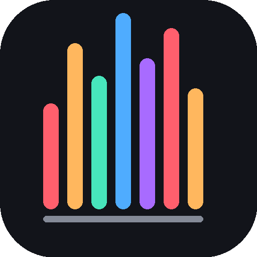
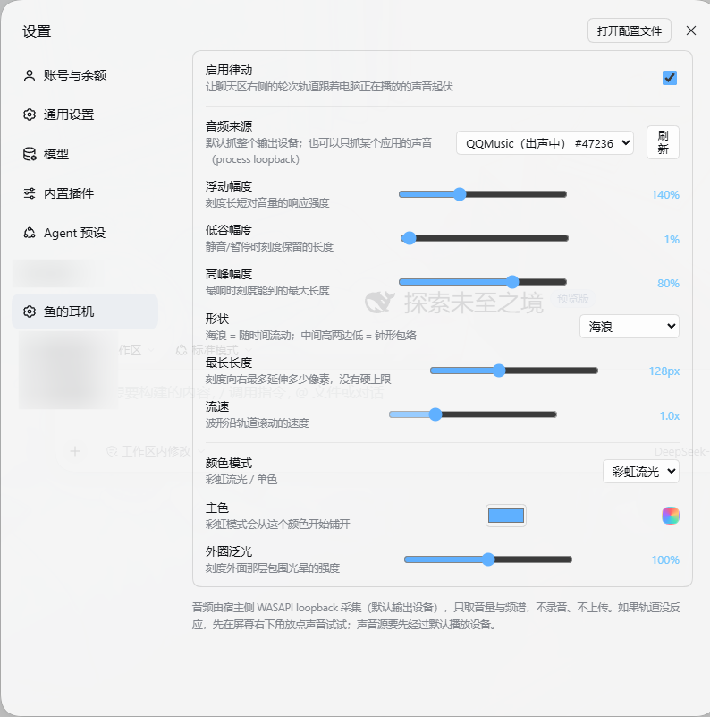
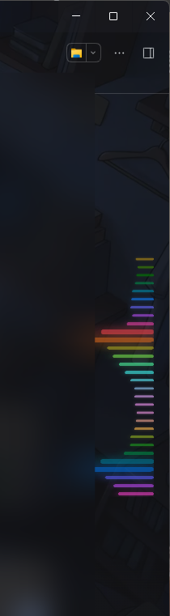

<div align="center"><a name="readme-top"></a>



# dsh-whale-pulse · 大肥鱼音律

> 让 DeepSeek Harness 的轮次轨道，跟着电脑正在播放的声音一起律动。

**简体中文** · [更新日志](CHANGELOG.md) · [反馈问题](../../issues)

[](LICENSE)
[](#-兼容环境)
[](#-它是什么)
[](CHANGELOG.md)

</div>

<details>
<summary><kbd>目录</kbd></summary>

- [🌟 它是什么](#-它是什么)
- [✨ 功能](#-功能)
- [🖼️ 效果预览](#️-效果预览)
- [🌐 兼容环境](#-兼容环境)
- [💻 安装](#-安装)
- [⚙️ 设置](#️-设置)
- [🏗️ 架构](#️-架构)
- [❓ 常见问题](#-常见问题)
- [🔧 开发](#-开发)
- [🗺️ 路线图](#️-路线图)
- [🤝 参与贡献](#-参与贡献)
- [📄 许可](#-许可)

</details>

## 🌟 它是什么

DSH 的聊天区右侧有一列竖着的小刻度（**轮次轨道**），点一下能跳到某一轮对话。
本插件把它变成一块「声波屏」：读取电脑当前的音频输出，算出 16 段频谱，
再驱动每根刻度的长度、厚度、颜色和辉光。

- 音频由**宿主侧 WASAPI loopback** 采集（OBS 同款做法），不是浏览器录音接口；
- 默认抓整个输出设备，也可以**只抓某一个应用**（process loopback）；
- 只算音量和频谱，**不录音、不落盘、不上传**。

## ✨ 功能

- [x] 每根刻度独立伸缩，像一道沿轨道流动的声波
- [x] 两种形状：**海浪**（随时间流动）/ **山峰**（静止钟形，中间高两边低）
- [x] 按应用抓取：只跟 QQ 音乐、Chrome、游戏等某个应用的声音律动
- [x] 彩虹流光 / 单色，任意取色
- [x] 浮动幅度、低谷幅度、高峰幅度、流速、外圈泛光、最长长度全部可调
- [x] 上冲快、回落慢；间奏/换气不掉，暂停才安静
- [x] 完全静音时保留一层很轻的底波浪

## 🖼️ 效果预览

**设置 → 鱼的耳机**（可调项一览）



**聊天区右侧的轮次轨道**（跟着音乐起伏）



## 🌐 兼容环境

| 系统 | 状态 | 说明 |
| --- | --- | --- |
| Windows 10/11 | ✅ 完整支持 | WASAPI + PowerShell，系统自带 .NET Framework 4.x |
| macOS | 🧪 实验性 | `ffmpeg` + `BlackHole` 虚拟声卡，尚未真机验证 |
| Linux | ❌ 暂不支持 | PulseAudio monitor source 需要额外配置 |

> process loopback（按应用抓取）需要 Windows 10 2004（Build 19041）以上。

## 💻 安装

源码放 `<DSH_HOME>\plugins\dsh-whale-pulse\`（`<DSH_HOME>` 一般是 `C:\Users\<你>\.dsh`），
然后在 `<DSH_HOME>\profiles\desktop\` 做三件事：

1. `package.json` 的 `dependencies` 加一行：

   ```json
   "dsh-whale-pulse": "link:../../plugins/dsh-whale-pulse"
   ```

2. 同一个文件里 `dsh.profile.bundles` 数组加一行 `"dsh-whale-pulse"`；

3. 建一个 junction：

   ```powershell
   New-Item -ItemType Junction `
     -Path "$env:USERPROFILE\.dsh\profiles\desktop\node_modules\dsh-whale-pulse" `
     -Target "$env:USERPROFILE\.dsh\plugins\dsh-whale-pulse"
   ```

4. **重启 DSH**（宿主注入表和客户端模块都在启动时收集一次，刷新页面不够）。

## ⚙️ 设置

**设置 → 鱼的耳机**：

| 项 | 范围 | 说明 |
| --- | --- | --- |
| 启用律动 | 开 / 关 | 总开关 |
| 音频来源 | 默认设备 / 指定应用 | 指定应用走 process loopback，列表每 10 秒自动刷新 |
| 浮动幅度 | 0~400% | 刻度对音量的响应强度 |
| 低谷幅度 | 0~60% | 静音/暂停时刻度保留的长度 |
| 高峰幅度 | 35~100% | 最响时刻度能到的最大长度 |
| 形状 | 海浪 / 山峰 | 海浪随时间流动；山峰是静止钟形 |
| 流速 | 0.3x~3x | 波形沿轨道滚动的速度（仅海浪） |
| 颜色模式 | 彩虹 / 单色 | 彩虹按刻度序号铺色相；单色用取色器 |
| 主色 | 任意颜色 | 单色直接用；彩虹从它的色相开始铺 |
| 外圈泛光 | 0~200% | 刻度外面那层包围光晕 |
| 最长长度 | 12~300px | 刻度最多向右延伸多远 |

- 律动配置存在浏览器 `localStorage` 的 `dsh.whale-pulse.v1`；
- 音频来源存在宿主侧 `<DSH_HOME>/whale-pulse-config.json`，重启后保持。

## 🏗️ 架构

```
宿主（Electron / Node）
  ├─ runtime/probe.ps1        PowerShell + NAudio 常驻采集器
  │     ├─ 默认设备模式：WASAPI loopback
  │     ├─ 应用模式：-TargetPid <pid>，走 process loopback
  │     └─ 每 50ms 输出一行 JSON：{"peak":…,"rms":…,"bands":[16 段]}
  ├─ runtime/sessions.ps1     枚举有窗口/在出声的应用
  ├─ /dsh-whale-pulse/level    页面轮询电平
  ├─ /dsh-whale-pulse/processes 应用列表
  ├─ /dsh-whale-pulse/config   切换音频来源
  └─ /dsh-whale-pulse/report   页面诊断上报

浏览器
  ├─ lib/client.js           客户端插件：注册「设置 → 鱼的耳机」页
  └─ runtime/pulse.js/css    找轨道、轮询电平、写 CSS 变量
```

## ❓ 常见问题

| 现象 | 处理 |
| --- | --- |
| 设置里没有「鱼的耳机」 | 客户端 bundle 没被加载，确认 `package.json` 有 `dsh.client`，并重启 DSH |
| 轨道没反应 | 看 `<DSH_HOME>/whale-pulse-host.log` 有没有 `probe ready`；确认有声音在播放 |
| 刻度被截断 | 调大「最长长度」，容器宽度会跟着走 |
| 完全不亮 | 系统「减少动画」（`prefers-reduced-motion`）开着时律动会被禁用 |
| 换应用后没反应 | 等 10 秒自动刷新，或点「刷新」；应用 PID 变了要重新选 |

## 🔧 开发

```powershell
# 语法自检
node --check lib/index.js
node --check lib/client.js
node --check runtime/pulse.js

# 采集器单独测
powershell -File runtime/probe.ps1
powershell -File runtime/probe.ps1 -TargetPid 1234

# 应用列表
powershell -File runtime/sessions.ps1
```

- 改宿主/运行时后**重启 DSH**；只改 `lib/client.js` 可以刷新页面；
- 宿主日志在 `<DSH_HOME>/whale-pulse-host.log`。

> [!TIP]
> 改 `.ps1` 时别用 `Set-Content` 覆盖：PowerShell 5.1 读无 BOM 的 UTF-8 中文脚本会乱码，文件要保留 UTF-8 BOM。

## 🗺️ 路线图

- [ ] 补效果截图与演示 GIF
- [ ] macOS 真机验证（BlackHole 方案）
- [ ] 更细的频谱分段（16 → 32）
- [ ] 跟随系统主题自动切换配色
- [ ] Linux 支持（PulseAudio monitor）

## 🤝 参与贡献

见 [CONTRIBUTING.md](CONTRIBUTING.md)。Bug 与想法走 [issue](../../issues)，PR 请保持改动聚焦。

## 📄 许可

MIT，详见 [LICENSE](LICENSE)。

随包分发的 **NAudio 1.10.0** 同样是 MIT（Copyright © Mark Heath & Contributors）。

<a name="readme-bottom"></a>
<div align="right"><a href="#readme-top">回到顶部</a></div>
